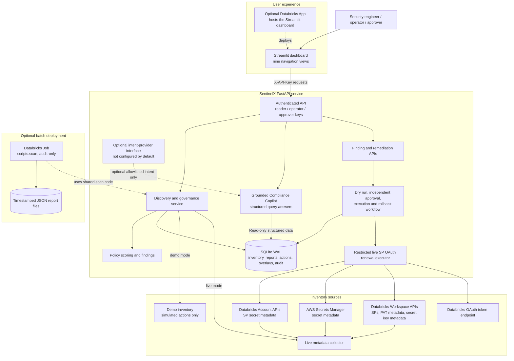
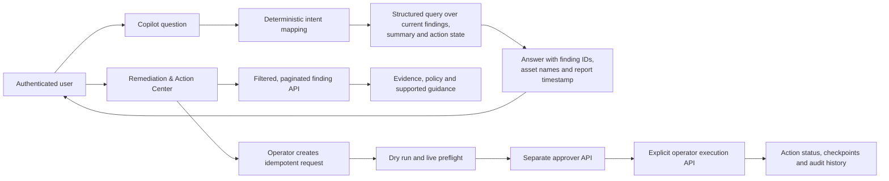
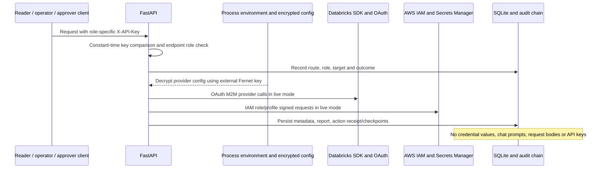

# Architecture

## Stack and Ownership

Python 3.11+, FastAPI, Streamlit/Altair, SQLite WAL, Databricks SDK/OAuth,
boto3/IAM, Fernet, pytest/unittest/Stubber, Docker, and GitHub Actions.
SQLite contains assessed metadata, report snapshots, action state, metadata
overlays, and hash-chained audit events. Credential values are not stored there.
The Copilot answers from structured report data; no LLM or Model Serving endpoint
is configured. Its optional intent-provider protocol is only an injection point
for an approved future classifier.

The local launcher runs one API and one dashboard. The API process owns the SQLite
database and scan scheduler. The Databricks App deployment hosts only Streamlit;
FastAPI must run separately on persistent storage. A Databricks Job can run a
separate audit-only scan and write JSON reports, but it does not share the API's
SQLite history.

## 1. System Architecture



Demo mode uses sample inventory and simulates metadata changes locally. Live
discovery reads provider metadata. Live remediation is limited to the configured
Databricks service-principal OAuth renewal path and owner metadata assignment.
The optional batch job is not a remediation worker.

## 2. Scan and Reporting Flow

```mermaid
sequenceDiagram
    participant Timer as API scan scheduler
    participant Job as Optional Databricks Job
    participant Gov as Governance service
    participant Collector as Demo or live collector
    participant DBX as Databricks APIs
    participant AWS as AWS Secrets Manager
    participant Risk as Scoring engine
    participant Store as API SQLite database
    participant UI as Streamlit dashboard
    participant API as FastAPI

    Timer->>Gov: Scan at configured interval (default 300 seconds)
    Job->>Gov: Run separate audit-only scan
    Gov->>Collector: Collect inventory and coverage
    alt Demo mode
        Collector-->>Gov: Sample assets
    else Live mode
        Collector->>DBX: List identity, PAT and secret metadata
        Collector->>AWS: List and describe secret metadata
        Note over Collector,AWS: Discovery does not retrieve secret values
        Collector-->>Gov: Assets and coverage/errors
    end
    Gov->>Gov: Apply registry metadata and compare mapped metadata
    Gov->>Risk: Assess assets against policy
    Risk-->>Gov: Scores, findings and recommendations
    Gov->>Store: Save inventory, report snapshot and audit event
    Job-->>Job: Write JSON report artifact; no shared API history
    UI->>API: Authenticated summary, findings, history or report request
    API->>Store: Read current structured data
    API-->>UI: Metadata and report references
```

Discovery errors are recorded without replacing a prior complete inventory when
coverage is partial. Provider exception text and request bodies are not copied to
the audit log. JSON/CSV exports contain metadata and assessments, not credential
values.

## 3. Copilot and Action Center



The Copilot receives assessed metadata and action status only; it has no tools for
provider writes or action execution. The current implementation does not call an
LLM. A dependency-injected `IntentProvider` may classify a question into an
allowlisted intent, but response facts and text are computed from the report.
Conversation history is retained in the Streamlit session, not persisted by the
API. Team-specific access is unavailable until authenticated user-to-team mapping
is implemented; the existing API keys identify roles, not individuals.

Finding IDs are deterministic hashes of an asset ID and finding code. The Action
Center validates a submitted finding against the current inventory, attaches that
ID to a remediation action, and uses the existing approval state machine. It does
not make unsupported actions executable.

## 4. Authentication and Data Boundaries



The dashboard uses an API reader key in live deployments. Databricks App
authentication protects access to the App but is not forwarded as an individual
identity to the API. TLS, network isolation, per-person SSO, and secret delivery
are deployment responsibilities. The live executor and discovery clients use
separate Databricks service-principal configuration, but run in one API process.

## 5. Supported Live Renewal and Rollback

```mermaid
sequenceDiagram
    participant Operator
    participant Approver
    participant API as FastAPI workflow
    participant Executor as Live renewal executor
    participant Account as Databricks Account API
    participant Workspace as Databricks Workspace API
    participant OAuth as Databricks OAuth endpoint
    participant AWS as AWS Secrets Manager

    Operator->>API: Create renewal request
    Operator->>API: Dry run
    API->>Executor: Preflight explicit binding and permissions
    Executor->>Account: Verify principal and source secret metadata
    Executor->>Workspace: Verify existing scope/key
    Executor->>AWS: Verify one AWSCURRENT and no AWSPENDING
    API-->>Operator: Plan; no provider writes
    Approver->>API: Independently approve reviewed request
    Operator->>API: Explicit execute (approval required)
    API->>Executor: Claim once and checkpoint intent
    Executor->>AWS: Read prior bound OAuth JSON as rollback material
    Executor->>Account: Create replacement SP secret
    Executor->>AWS: Stage replacement as AWSPENDING
    Executor->>OAuth: Validate new OAuth credential
    Executor->>Workspace: Update configured secret key
    Executor->>AWS: Promote new version to AWSCURRENT
    Executor->>AWS: Remove AWSPENDING and verify stage
    API-->>Operator: Succeeded only after provider checks
    Operator->>API: Request a separate rollback action
    Approver->>API: Approve rollback independently
    API->>Executor: Restore prior Databricks value and AWS version
```

The live workflow does not revoke or delete the old service-principal credential.
Provider calls and SQLite cannot form a distributed transaction; checkpoints and
receipts support reconciliation, while some crash windows require manual recovery.
OAuth issuance does not prove dependent workload health. Standalone live AWS
rotation, arbitrary PAT rotation/revocation, automatic privilege reduction, and
irreversible deletion are not implemented.
